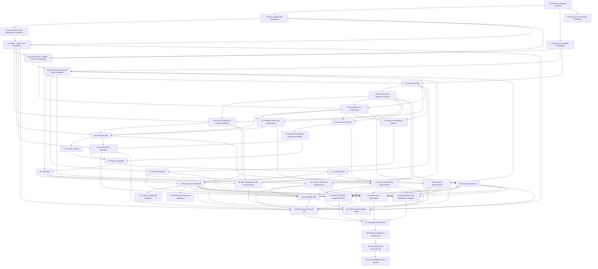

# Dependency map

Numbering is a recommended topological order, not a requirement to finish every lower number before an independent branch. Every solid edge is a mandatory VERIFIED predecessor; Blocks is its inverse. Domain implementation and quality verification remain scoped to their owner phases.

## CRITICAL PATH

Without estimates, no mathematically longest-duration path can be claimed. The structural launch-critical chain is baseline → architecture/design/i18n plus database → auth → admin authority → courses/curriculum → catalog and entitlement → video/player/progress plus assessment domain/attempts/UI → completion → certificates/paths/dashboard → content/admin, security, accessibility, responsive, performance and monitoring gates → production infrastructure → deployment → final E2E → launch readiness.

Paid launch additionally requires courses + entitlement → orders → Kashier → commerce administration → production gates. AI requires real curriculum + entitlement + player; its tests and content/privacy readiness join the release gates. Course completion deliberately follows assessment grading. Commerce adds the order-item FK to enrollment after order_items exists, avoiding a forward schema dependency. Admin authority precedes authoring even though full admin UI waits for the domains it manages.

## PARALLELIZABLE WORK

- After Phase 00: Phase 01 architecture verification and Phase 04 database verification are independent.
- After Phase 01: Phase 02 design verification can proceed while Phase 04 closes hosted evidence.
- After curriculum/entitlements: Phase 14 assessment domain can proceed alongside Phase 11 video; Phase 15 grading can proceed alongside Phase 12/13 player/progress once their individual gates pass.
- After Phase 07 and Phase 10: Phase 19/20 commerce can proceed alongside learning/assessment work; paid grants use the shared entitlement contract.
- After Phase 08/10/12: Phase 25 AI can proceed alongside later completion/certification/commerce work.
- After their own prerequisites: Phase 27 course admin, Phase 28 learner admin and Phase 29 commerce admin may proceed independently; coordinate shared audit migrations.
- After feature prerequisites: SEO, accessibility, performance, security and observability audits can run independently. Phase 32 consumes accessibility fixes; Phase 36 consumes content/legal/SEO readiness. Phase 37 waits for all listed release gates.

Parallelizable is a planning property, not authorization to spawn agents or execute multiple phases. Coordinate shared migrations, types, messages and UI files. A phase can start only when ALL its listed predecessors are VERIFIED, even if another independent branch is progressing.

## Deferred scope and launch

Phases 23/24/26 have DEFERRED product disposition and are not release dependencies while excluded. Phase 36 verifies their truthful approved route/navigation treatment. If activated, add the activated phase as a predecessor of the relevant quality gates (31–36) and require it in production readiness; do not silently mark it VERIFIED or skip it. Organizations, review/rating systems, subscriptions and AI history require separate future phase contracts after explicit scope approval.
